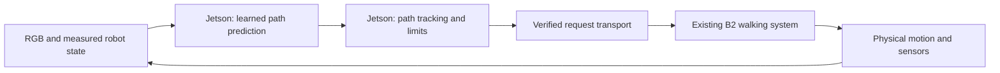
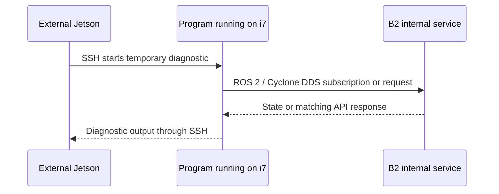

# 予測経路からB2が動くまで

[English](control-loop.md) · [文書目次](../README.ja.md) · [モデル内部の計算](ticvla-explained.ja.md) · [学習](ticvla-training.ja.md)

> 文書種別：**解説**．一つの予測から，追従計算，通信，歩行，フィードバックまで追う．数値は計算の例であり，承認済みのB2動作設定ではない．機体を動かすコマンド列は載せない．完了した試験は[記録](../records/README.ja.md)，次の現地作業は[受信専用の操作手順](../how-to/next-visit.ja.md)へ分ける．

外付けJetsonは，B2をどこへ進めるか決める計算機になれる．ただし，B2内部の全コンピューターを置き換えるわけではない．学習した予測を既存の歩行機能が理解する要求へ変え，実際に通る通信経路で届け，何が起きたか確認する必要がある．LANケーブルを挿す操作は，この連なりの一部分である．

## 1．一回の判断をシステム全体で追う

現在の写真，「通路に沿って進む」という指示，測定した機体速度を考える．モデルが予測した曲線に，前へ1 m，左へ0.2 mの点があるとする．「上位」「下位」という名称で止めず，この点がどう処理されるか追う．

| 段階 | 実際の計算・処理 | 出力 | 設計上の実行場所 |
|---|---|---|---|
| 観測 | RGBを取得し，運動・姿勢を受信して時刻を対応させる | 画像と数値の状態 | 外付けJetson．内蔵側の状態は検証した接続から受信 |
| 予測 | 現在画像の特徴，完成済みの意味情報，行動側を計算 | `(1.0, 0.2)`などの近くの位置 | JetsonのGPU |
| 追従 | 使う点を選び，要求する速度・旋回を計算 | `(vx, vy, yaw_rate)` | JetsonのCPU |
| 検査・送信 | 操作権限，情報の古さ，上限を確認し，期限を持つ要求へ変換 | 機械が解釈する移動要求 | Jetson，または意図的に実装するi7の中継 |
| 実行 | 既存のB2サービスが要求を歩行機能で処理 | 胴体・脚の運動 | B2の既存制御システム |
| 再観測 | 実際の位置・速度と次の画像を観測 | 更新した状態と場面 | B2のセンサーと外付けカメラからJetsonへ |

追従の計算はVLMより小さいため，CPUで扱うのは普通の設計であり，大きな言語モデルは必要ない．さらに歩行側は，要求された胴体運動に合わせてバランスと関節を調整する，別の課題を解く．



矢印はデータの受渡しを表し，全てが既につながった証拠ではない．実装済み・未実装の対応は11節にまとめる．特に，Pythonのオブジェクトに速度が入っただけでは，ロボットへ要求を送信したことにならない．

## 2．位置・速度・関節指令は違う量である

モデルの`(1.0, 0.2)`は，基準姿勢からのメートル単位の**位置**である．B2の`Move`は，前進速度，横移動速度，向きの変化速度という**速度**を受け取る．「xが1 mの場所へ行く」と「0.1 m/sで動く」は違う要求であり，どちらも各モーターの角度を指定していない．

**経路，path**は空間上の曲線，**軌跡，trajectory**は各0.1秒後などの時刻も加えた位置の指定である．その形を追うことと，指定時刻も守ることは別の制御課題になる．現在のオフライン追従器は空間上の先の点を追い，モデルの到着予定時刻を拘束しない．

例えば，xが0.1 mと0.2 mの二点へ，0.1秒と0.2秒の予測時刻が付いていれば，区間の想定速度は1 m/sとなる．その座標をそのまま速度として送ったり，最終変位を推論全体の時間で割ったりすると，別の意味になる．B2では実現できる速度の決め方を選び，その速度で学習した時刻付き経路がどう使えるかも調べる必要がある．

既存の歩行機能は，胴体の運動要求を受け，自分の測定と制御計算で各関節を動かす．単純化した説明なら，足先の動きを作り，関節の幾何を解き，モーターの追従を制御する流れが考えられる．これは**歩行制御の説明例であり，Unitree独自の内部方式を同定した結果ではない**．測定から，全ソフト構造，各部分の実行先，制御基板からモーターまでの全バスが判明したわけではない．

Intel CPUでも，通信，センサー処理，多くの制御計算を行える．小さな学習済み方策をCPUで動かす場合もあり，全ての制御に大きなGPUが必要なわけではない．大きなTIC-VLAの画像・言語計算は外付けJetsonへ割り当てる．内蔵i7は，同じ推論を担当しなくても，開発や通信の計算機として役立つ．

## 3．予測した一点から速度要求を計算する

**経路追従器**は，幾何学的な経路を胴体運動の要求へ変換する．点の選び方と速度の決め方が必要になる．このレポジトリの[`PathTracker`](../../src/b2_tic_vla/control.py)はオフラインの候補実装であり，実機で調整済みのB2制御器ではない．

最初に，不正・古い・対応の取れていない入力を拒否する．次に前方の点から，設定した**先読み距離，lookahead distance**に達する最初の点を選び，なければ最後の前方点を使う．先読みは，ほぼ同じ位置へ細かく向き直すのではなく，少し先へ進路を向ける考え方である．この実装は既存の点を選び，正確な先読み距離との交点を補間しない．

選んだ機体座標の点$(x,y)$に対し，**pure pursuit**という円弧の幾何に基づく規則を使う．

$$
\kappa=\frac{2y}{x^2+y^2},\qquad \omega=v\kappa.
$$

$x$・$y$の単位はm，$\kappa$は曲率で1/m，$v$は前進速度でm/s，$\omega$は旋回速度でrad/sである．xを前，yを左とするなら，正の曲率は左旋回となる．平面上を前進する運動の近似であり，四脚の足運びそのもののモデルではない．

$(1.0,0.2)$では$x^2+y^2=1.04\ \mathrm{m^2}$なので，$\kappa\approx0.3846\ \mathrm{m^{-1}}$となる．$v=0.10\ \mathrm{m/s}$を選ぶと，$\omega\approx0.03846\ \mathrm{rad/s}$である．速度は制御器の設定で選んだ値であり，点から自動的に決まった値ではない．

コードは速度・旋回の上限を設け，急な曲線では想定速度を下げ，前の候補要求からの変化量も制限する．例えば加速度上限0.20 m/s²で0.10秒なら，前進速度の変化は0.02 m/sまでになる．静止からの最初の候補は，0.10 m/sではなく0.02 m/sになり得る．並進と旋回の変化制限は独立にかけるため，過渡状態の要求は元の曲率比を厳密に保つとは限らない．この追従器を選ぶ前に，その振る舞いも実機で評価する必要がある．

現在の制限は具体的には次である．

- 横移動速度は常にゼロ．実装上の選択であり，B2一般の制約ではない．
- 最終目標へ到着した際の自動停止はない．最後の前方点を選ぶだけでは到着制御にならない．
- 障害物との余裕や，B2の胴体・脚全体が占める範囲を計算しない．
- 状態の有効性は調べるが，要求速度と実測速度の誤差で速度を補正しない．
- 加速度の上限は候補要求に対するものであり，実際の物理加速度を測って制限するものではない．
- ロボットへの送信部と物理的な停止処理を持たない．

`Limits`の既定値は全てソフト準備の例である．検査を通っただけで，動作が許可されたり，十分な空間が確保されたりするわけではない．

## 4．SDKの関数は実際には何を送るのか

**API**は，関数名，引数，その意味などを定めた取り決めである．**SDK，software development kit**は，そのAPIを使うためのコードを提供する．UnitreeのSDKは，対応する要求を作る呼出しを用意するもので，カメラのモデルや機体の歩行サービスを置き換えるものではない．

固定版の[B2用`SportClient`](https://github.com/unitreerobotics/unitree_sdk2_python/blob/814556d15970dd2ecf1c9984e845ca02ab07e206/unitree_sdk2py/b2/sport/sport_client.py)は，`Move(vx, vy, vyaw)`を`x`・`y`・`z`の項目を持つJSONの文字列へ変換する．ここで`z`に入るのは**旋回速度**であり，高さや上向きの速度ではない．[API定義](https://github.com/unitreerobotics/unitree_sdk2_python/blob/814556d15970dd2ecf1c9984e845ca02ab07e206/unitree_sdk2py/b2/sport/sport_api.py)では，Moveの番号は1008，sport APIの版は`1.0.0.1`である．

上の説明用の要求なら，引数部分は次の内容になる．

```json
{"x": 0.10, "y": 0.0, "z": 0.03846}
```

これはデータ内容の説明であり，今送るためのコマンドではない．SDKは，引数へ要求の識別子とAPI番号を付け，型の決まったメッセージへ符号化し，通信チャネルへ書く．機体側の対応するサービスが受信して解釈する．**サービス**は他のプログラムへ機能を提供する実行中のプログラムであり，手元で関数が呼べただけでは，それが受信した証拠にならない．

この固定版の`Move`は，**個別の返答を待たない**呼出しを使う．したがって，ローカルで成功が返っても，機体が各要求へ応答した証拠にも，実際に移動した証拠にもならない．別の関数では要求と返答を照合する方式を使う．[client](https://github.com/unitreerobotics/unitree_sdk2_python/blob/814556d15970dd2ecf1c9984e845ca02ab07e206/unitree_sdk2py/rpc/client.py)，[要求処理](https://github.com/unitreerobotics/unitree_sdk2_python/blob/814556d15970dd2ecf1c9984e845ca02ab07e206/unitree_sdk2py/rpc/client_base.py)，[チャネル接続](https://github.com/unitreerobotics/unitree_sdk2_python/blob/814556d15970dd2ecf1c9984e845ca02ab07e206/unitree_sdk2py/rpc/client_stub.py)で確認できる．

`StopMove`・`StandDown`・`Damp`は別の要求である．移動を止めること，胴体を下げること，能動的な支持を弱めることは異なる動作であり，全て「停止に似ている」からといって代用できない．返り値と，目視・測定した姿勢変化も区別する．

SDKには`TrajectoryFollow`もあるが，点数が同じ「30」でもTIC-VLAの配列を直接渡せるわけではない．その点には，時刻，x，y，yaw，vx，vy，旋回速度が必要である．現在の出力はXYと接続コードが付けた時刻ラベルだけである．座標規約，向き，微分から作る速度，時間，サービスの挙動を確認して初めて，その形式のメッセージを作れる．対応する接続処理は，ここでは実機用に完成していない．

## 5．SDK・ROS 2・Cyclone DDSの関係

**DDS**は**Data Distribution Service**の略で，参加プログラム間で型の決まったデータを交換する通信規格である．作る側が配信し，受ける側が**トピック**という名前付きのデータ系列を購読する．通信相手を見つけ，メッセージの型や配送設定が対応する必要がある．**Domain**は参加者をグループ分けする番号であり，同じ番号にするだけでは届かないネットワークを直せない．

**Cyclone DDS**は，DDS規格を実装したソフトの一つである．今回の通信層で，相手の発見，データの符号化・配送を扱う．Cycloneは実装の名称であり，別のロボット方策やROSの版ではない．

**ROS 2**は，アプリケーションの構成，メッセージ型，配信・購読などのライブラリを提供する．実行するROSプログラムを**ノード**と呼ぶことが多い．内蔵側の実験では，Python用ライブラリ`rclpy`とUnitreeのメッセージ型を使った．ROS 2の通信実装との接続層を**RMW**と呼び，`rmw_cyclonedds_cpp`を選ぶことで下にCyclone DDSを使った．

したがって，関連する二つの書き方がある．

| クライアントの書き方 | アプリケーションが使うもの | 今回の下位通信 |
|---|---|---|
| Unitree SDK | B2 sportなどの関数 | SDKのチャネル・要求応答実装とCyclone DDS |
| ROS 2の診断プログラム | Unitree型を使う配信・購読 | `rclpy` → RMW → Cyclone DDS |

SDKとROS 2は，どちらか一方しか導入できないものではなく，全SDKプログラムをROS 2の中で動かす必要もない．ROSのメッセージを使うプログラムで，SDKの便利な関数を呼ばずに対応する要求交換を実装できる．内蔵の一時診断が行ったのはこちらである．APIが通ることと，独立したSDK Pythonパッケージが導入されていることを区別する理由になる．

DDSにも実際のネットワーク経路が必要である．使う通信口，アドレス・経路，相手の発見用通信，実データ，通信を通す規則が対応しなければならない．相手の発見，pingの成功，意味のある型付きメッセージの受信は別の観測である．各層は[ネットワークの解説](network-topology.ja.md)，外付け側に別途作ったSDK環境は[Unitree実行環境](../reference/unitree-runtime.ja.md)で説明する．

## 6．現在のJetsonからB2への通信はどこを通るのか

確認した配線は，AnkerのUSB Ethernet変換器を通して開発用i7へ届く．そのUSB側の通信口と，i7の機体内部向けEthernetは別である．Linuxに二つの通信口があっても，自動的に一方の通信をもう一方へ転送するわけではない．

完了した診断の経路は次である．



**SSH**は認証して相手のシェルやプログラムを実行する通信である．この試験で外付けSDKから`Move`を直接送ったわけではない．Jetsonが**i7上に**プログラムを起動し，そのプログラムがi7の内部通信口を使った．常駐の転送サービスを導入した証明ではない．

継続運用の設計には，異なる三つの選択肢がある．

1. **機体ネットワークへの直接接続**．ロボットの参加プログラムへ届くことを確認した経路にJetsonをつなぎ，その通信口を使う設定でDDSの実交換を検証する．内部LANへつながると物理的に確認した端子も候補だが，別の変換器の購入が必須だと判明したわけではない．
2. **i7によるネットワーク転送**．**ブリッジ**はEthernetのフレームを通信口間で転送し，**ルーター**は経路に従ってIPパケットをネットワーク間で転送する．どちらもネットワークの振る舞いを変えるため，アドレス，戻り経路，相手発見，フィルターを調べる必要がある．SSHでログインしたりIPを一つ足したりすること自体がブリッジではない．
3. **i7上のアプリケーション中継**．Jetsonから定義済みの小さな要求を受け，検査して機体側の要求を作り，逆向きには測定状態を返すプログラムを意図的に実装する．機体のDDS通信全体を外へ出さずに境界を越えられるが，通信形式，順序，期限切れ，再起動，故障時の扱いが必要になる．「中継」は，ここで既に実用化したソフトの名前ではない．

次回の状態streamは，期限付きSSHの診断であり，完成した移動要求の中継ではない．状態がJetsonへ継続して届くかを測り，上の方式を選ぶ材料にする．実行版・通信口・firewallの挙動は，起動した実機で調査する部分が残る．Dockerがあるだけでfirewall問題の存在や解決を決めず，関係する実際の規則とパケット経路を調べる．

以前の診断で内部サービスは応答したが，その物理的な実行先や，そこからモーターまでの全経路は同定していない．Unitreeの標準B2説明は機体機能用と開発用の計算機を分けるが，各サービスが特定CPU上の検証済みプロセスになるわけではない．[接続記録](../records/b2-connection-2026-11-03.ja.md)へ，調べた範囲を残している．

## 7．実際の動きはどうモデルへ戻すのか

**フィードバック**は，行動の結果を測り，次の行動を修正することである．0.1 m/sを要求しても，胴体が正確に0.1 m/sで進んだ証拠にはならない．加速，旋回，滑り，既存の歩行制御によって結果が変わり得る．

ナビゲーション側には，測定した姿勢・速度，定義した単位・軸，画像と意味情報の基準への時刻対応が必要になる．**オドメトリー**は時間に沿って移動を推定するもので，誤差が蓄積することがあり，必ずしも世界全体で正確な位置ではない．項目名が`position`，座標名が`base_link`でも，物理的な規約との一致は検証が必要である．

意味情報の基準の世界位置を$p_r$，向きを$\psi_r$，現在を$(p_t,\psi_t)$とすると，基準座標での変位は次になる．

$$
\Delta p_r=R(\psi_r)^\mathsf{T}(p_t-p_r).
$$

これは，保存した特徴が表す画像からの機体の移動である．まだ完成していない新しい意味情報の要求時の姿勢を使ってはいけない．向き変化を入力する仕様なら，それも対応させる．公開版の6数値入力には，論文と違い，独立した向き変化量の枠がない．

古い経路の点も同様に補正する．基準座標の点$q_r$について，

$$
q_W=p_r+R(\psi_r)q_r,\qquad
q_t=R(\psi_t)^\mathsf{T}(q_W-p_t).
$$

例えば，基準が世界の原点・向きゼロ，点が$(1.0,0.2)$ mとする．機体が$(0.4,0)$ mへ移動して左へ90度向いた後，同じ世界上の点は現在の機体座標では$(0.2,-0.6)$になる．`(1.0,0.2)`をそのまま再利用すると別の場所を指す．新しい予測で経路を置換してもよいが，それまで古い点を使うなら，検証した座標変換と古さの上限が必要になる．

時刻も重要である．**撮影時刻**は露光，**受信時刻**はソフトがデータを受け取った時点，**完成時刻**は推論が終わった時点であり，代用できない．Jetsonとi7の単調時計は起点が独立している．直接引き算しても片道遅延にならない．元の時計の時刻を保持し，関係を確立してから測定を対応させる．

現在のカメラデモは運動ゼロを仮定する．これを置き換えるには，トピック名だけでなく，測定データの経路全体を実装する．[非同期入力の参照資料](../reference/asynchronous-runtime.ja.md)に必要な情報を定め，[次回手順](../how-to/next-visit.ja.md)では継続した状態記録から始める．

## 8．数秒の推論を待つ間は何が起きるのか

[モデルの章](ticvla-explained.ja.md)では，次の意味情報を計算中も，完成した組で現在の行動を計算できる仕組みを説明した．一つの依存関係は解けるが，**観測から指令まで全体**を必要な時間内で動かす仕事は残る．

三つの周期を区別する．

- カメラ・状態の取得：新しい測定が届く頻度．
- 行動予測：新しい現在観測を使い，経路を計算し直す頻度．
- 指令処理：予測中も要求を検査・更新・期限切れにする扱い．

滑らかなプレビューで証明できるのは最初だけで，行動の計算が速いことは二番目の一部だけである．同じ速度を高頻度で送信しても，観測や判断が新しくなるわけではない．

意味情報の計算に3秒かかっても，現在画像を使う有用な行動更新が0.15秒ごとに得られるなら，毎回3秒待たずに反応できる．行動側も3秒止まるなら，意味情報のスレッドを分けただけでは制御の問題を解けない．CPUの割当て，共有GPUの競合，入力転送，待ち行列も関係する．

同期の全体予測時間と，論文の行動側だけの時間を直接比較しない．[非同期実験](../records/async-shadow.ja.md)では，現在画像を含む行動の呼出し時間を別に測り，受け入れられる行動がない長い期間も記録した．最速の一回の逆数は，継続運転の頻度ではない．

オフライン追従器の古さ検査は，結果が今完成しても，観測が古ければ拒否できる．新しい結果という印を付けても写真が新しくなるわけではないためである．遅い実行が通るまで上限を伸ばす操作は，許す条件と入力分布を変えるもので，性能を改善するものではない．

将来の指令処理では，操作権限と**有効期限**を定める必要がある．受信側の**watchdog**は，モデルの進捗とは独立に更新停止・期限切れを監視する機能である．モデル出力の停止，古い測定，通信断，プロセス終了，現地操作者の介入に対する動作を決める．Pythonでゼロを作ったりSSHを閉じたりしても，実機停止の証拠にはならない．Unitreeの実際の期限・優先操作の挙動は，名前から推測せず物理的に確認する．

## 9．論文ではGo2で具体的に何をしたのか

[論文の実機節と図6](https://arxiv.org/html/2602.02459v2#S4.SS3)は，前方RGB画像と異なる計算機構成でGo2を評価する．図にRGB・深度カメラとLiDARが描かれていても，全ての情報がTIC-VLAへ入る証拠ではない．モデル入力と物理的なセンサー一覧は別の仕様である．

計算機の選択肢にはOrin NXとRTX 4060搭載ノートPCがあり，A6000でも評価している．報告した行動側／VLMの時間は，Orin NXで約120／4832 ms，RTX 4060で約86／3431 msである．著者の結果であり，こちらのAGX Orinの測定ではない．廊下，オフィス，広場，歩道の課題を使い，人の介入を失敗として数える．あらゆる状況で成功するシステムとして示しているわけではない．

論文と公開コードから意味情報・行動の接続を説明でき，シミュレーションでの実行・RLも調べられる．一方，確認した公開版には，Go2実機の全SDK呼出し，カメラドライバーの版，指令期限の挙動，現地調整済み追従値まで確定できる完全な起動構成はない．分かるモデル処理と一般的な制御変換は説明できるが，欠けた実機情報を創作したり，このレポジトリが再現済みと扱ったりしない．

特に3節の円弧の計算は**本プロジェクトの候補追従器**であり，著者のGo2実機制御器の検証済み複製ではない．実機実験は接続を進める根拠になるが，B2固有の受入試験まで済ませてくれるものではない．

## 10．B2へ移すと何が違うのか

全ての部品を必ず再学習する必要はない．画像・言語のナビゲーションを再利用し，B2の既存歩行制御へ機体の運動を任せられる可能性がある．ただし，関数の引数が同じだけでは同じ振る舞いを保証しない．

| 調べる違い | 結果へ影響する理由 | 対応を確認する方法 |
|---|---|---|
| 胴体幅・長さ・脚の可動範囲 | Go2の中心線が通れてもB2全体が通れるとは限らない | 寸法，経路の余裕，歩行で占める範囲を測る |
| カメラの高さ・角度・レンズ・切抜き | 見た目と距離の学習した関係が変わる | 取付け・校正を記録し，測定済みの場面で予測を比較 |
| 速度・加速度・旋回の応答 | 要求した曲線・時刻を胴体が追えない場合がある | モデルを使わない指令・測定の別試験 |
| 状態の座標系・単位・時計 | 数値自体が正しくても変換が誤れば無意味になる | 軸・単位と時刻対応の確認 |
| SDK系列・API・動作モード | Go2とB2で似た関数でも利用できる挙動は異なり得る | B2用定義と範囲を絞った機能試験 |
| ネットワークへの接続 | 現在のUSB配線はi7へ届くが，全機体参加者へ自動で届かない | 明示的な経路・フィルターと型付きデータの反復交換 |
| ソフト構成とGPUの割当て | Orinという名称だけでは同じ性能にならない | 固定した環境とループ全体の測定 |
| 現地優先操作と古い指令の扱い | クライアント故障後に操作権が残ってはいけない | 受信側の挙動試験と操作者の手順 |
| 目標到達と障害物への反応 | 有限の経路終点があるだけでは停止条件にならない | 明示的なロジックとナビゲーションの別評価 |

深度やLiDARは，別途設計する障害物との余裕の検査や地図作成へ使える．接続するだけではRGB方策が使う情報は増えない．モデル入力の項目を変えるには対応するモデルが必要で，学習も必要になり得る．独立した幾何的な検査を追加する設計とは別である．

同様に，AGX OrinのメモリがOrin NXより多いだけでは，今回のソフトの遅延が短くなる証明にはならない．精度形式，アテンション実装，返答の長さ，画像履歴，実行版，電力設定，並行処理が関係する．論文はFlashAttentionを使用し，こちらの確認済み環境は異なる読込・アテンション経路を使う．対応する処理を測定してから差を解釈する．

アクセスできるi7は，機体の接続調査や中継の配置先として役立ち，大きなナビゲーションモデルを動かす必要はない．将来の自立した実行は，MacのSSH接続，eduroamの電波，クラウドモデルの呼出しを必須にしない設計にする．Macは編集・監視に使える．現在の一時SSH診断は試験であって無人運用サービスではなく，起動・終了の管理は意図的に実装する作業として残る．

## 11．どこまで実装され，次に何をつなぐのか

| 部品 | 現在の実装 | モデル走行までに残ること |
|---|---|---|
| カメラ・モデルのデモ | 実RGB入力，返答，XY経路の表示 | 実測運動の入力と予測品質の評価 |
| 意味情報と行動の並行処理 | 時間を制限した，指令なしの実験 | 継続した可用性，実時刻，運動の入力 |
| 状態受信 | 内蔵ROSの一時診断．Jetsonへ流す新ツールを準備 | 次の起動時の受入試験と座標・時刻検証 |
| 追従 | オフラインの数値候補生成 | 到着，幾何，フィードバック，実機調整 |
| 動作要求の通信 | 既にダンピング中のDamp一回へ応答 | 移動の送信・中継，権限，有効期限の実装と検証 |
| 歩行・停止の確認 | メーカー既存機能を維持 | 適切な空間と現地操作者による別の目視・測定試験 |

したがって，次回はソフト・経路・フィルターを記録し，状態をJetsonへ流す．測定からデータの仕様を確立した後，実測運動を使う指令なしの予測へ進む．通信と実際の制御も，学習モデルから分けて試験する．この順番なら，問題が知覚，時刻，座標変換，通信配送，機体応答のどこにあるか切り分けられる．

コマンドは[次回の実行手順](../how-to/next-visit.ja.md)，実行済みの操作は[日付付きの接続記録](../records/b2-connection-2026-11-03.ja.md)を使う．この章は，なぜその操作が必要か，結果が全体のループへどう結び付くかを説明する．
