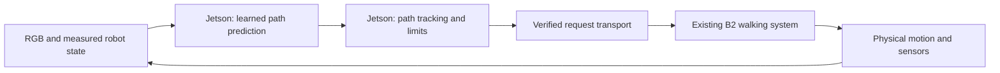
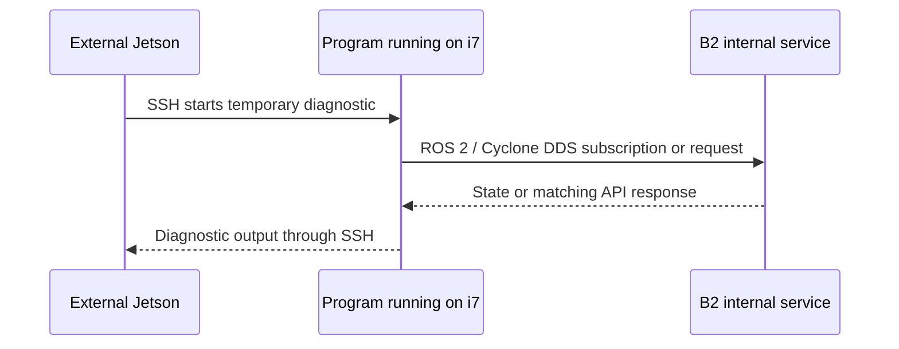

# From a predicted path to B2 movement

[日本語](control-loop.ja.md) · [Documentation](../README.md) · [Model computation](ticvla-explained.md) · [Learning](ticvla-training.md)

> Document type: **Explanation**. Follow one numerical prediction through tracking, communication, walking and feedback. Numbers illustrate calculations, not approved B2 motion settings. This chapter contains no command sequence for actuating a robot. Completed tests belong to [records](../records/README.md); the next physical visit uses [the receiving-only procedure](../how-to/next-visit.md).

The external Jetson can be the computer that selects where B2 should go. It does not replace all computers inside B2. It must turn a learned prediction into a request the existing walking system understands, deliver that request through a working communication path, and check what actually happened. An Ethernet cable establishes only part of this chain.

## 1. Follow a single decision through the whole system

Imagine a current camera picture, the instruction “Continue through the passage,” and a measured robot velocity. A model predicts a curve containing a point 1 m forward and 0.2 m left. We will follow that point, rather than stop at labels such as “high-level” and “low-level.”

| Step | Actual calculation or operation | Output | Execution location in the intended design |
|---|---|---|---|
| Observe | Acquire RGB; receive motion and pose; associate timestamps | Image and numerical state | External Jetson, with onboard state arriving through a verified link |
| Predict | Run current-image features and action expert using completed semantic context | Nearby positions such as `(1.0, 0.2)` | Jetson GPU |
| Track | Choose a usable point and compute requested speed/turn | `(vx, vy, yaw_rate)` | Jetson CPU |
| Validate/send | Check authority, data age and limits; encode a bounded request | A machine-readable motion request | Jetson, or a deliberately implemented i7 relay |
| Execute | Existing B2 service processes the request using its walking system | Body/leg motion | B2's existing control system |
| Measure again | Observe actual position, velocity and the next image | Updated state and scene | B2 sensors and external camera, returned to Jetson |

The tracker calculation is small compared with the VLM. Assigning it to a CPU is ordinary engineering; it does not need a large language model. The walking system solves a different task again: keeping balance and coordinating joints while following the requested body motion.



Arrows are data transfers, not proof that every component is connected today. Current implementations and missing links are listed in Section 11. In particular, a Python object containing a speed is not yet a transmitted robot request.

## 2. Positions, speeds and joint commands are different quantities

The model's `(1.0, 0.2)` is a **position** in metres relative to a reference pose. B2's `Move` interface accepts **velocities**: forward speed, lateral speed and heading-change rate. “Go to x = 1 m” and “move at 0.1 m/s” are different instructions. Neither specifies individual motor angles.

The **path** is the spatial curve. A **trajectory** adds timing, such as a desired position at each future tenth of a second. Following its shape and following its timing are different control problems. The current offline tracker follows spatial lookahead and does not enforce the model's predicted arrival schedule.

For example, two points at x = 0.1 m and x = 0.2 m with predicted times 0.1 and 0.2 s imply a nominal segment speed of 1 m/s. Sending those numbers directly as velocity, or dividing the final displacement by total inference time, changes their meaning. B2 commissioning must select an achievable speed policy and determine whether the learned timed path remains meaningful at that speed.

The existing walking system receives the body-motion request and uses its own measurements and control logic to produce joint behavior. A simplified walking controller could generate desired foot motion, solve joint geometry and regulate motor tracking. That is an explanatory example, **not an identification of Unitree's proprietary algorithm**. Our measurements do not establish its complete software structure, the physical host running each part or every bus between control boards and motors.

An Intel CPU can handle networking, sensor processing and many control calculations. Some learned policies can also execute on CPUs; a large GPU is not a prerequisite for every control task. The large TIC-VLA image/language calculation is assigned to our external Jetson. We do not need the onboard i7 to perform that same inference for it to be useful as a development and communication computer.

## 3. Calculate a speed request from one path point

A **path tracker** converts geometric guidance into body-motion requests. It needs a rule for choosing a point and a rule for choosing speed. Our [`PathTracker`](../../src/b2_tic_vla/control.py) is an offline candidate implementation, not a tuned B2 controller.

It first rejects invalid, stale or inconsistent inputs. From forward points it chooses the first whose distance reaches a configured **lookahead distance**, or the final forward point if none reaches it. Lookahead means aiming some distance ahead rather than steering toward an almost coincident point. This implementation selects an existing point; it does not interpolate an exact lookahead intersection.

For chosen body-frame target $(x,y)$ it uses **pure pursuit**, a geometric circular-arc steering rule:

$$
\kappa=\frac{2y}{x^2+y^2},\qquad \omega=v\kappa.
$$

$x,y$ are metres, $\kappa$ is curvature in inverse metres, $v$ is forward speed in m/s and $\omega$ is yaw rate in rad/s. With x forward and y left, positive curvature turns left. The formula describes a planar forward-motion approximation; it is not a model of a quadruped's individual footsteps.

For $(1.0,0.2)$, $x^2+y^2=1.04\ \mathrm{m^2}$ and $\kappa\approx0.3846\ \mathrm{m^{-1}}$. Choosing $v=0.10\ \mathrm{m/s}$ gives $\omega\approx0.03846\ \mathrm{rad/s}$. The speed was chosen by the controller configuration, not generated by the point itself.

The code then limits speed/turn, reduces nominal speed on tight curves, and limits changes relative to the previous candidate request. For example, an acceleration limit of 0.20 m/s² over 0.10 s permits a forward-speed change of only 0.02 m/s. From rest, the first candidate forward speed can therefore be 0.02 m/s rather than 0.10 m/s. Angular and linear slew limits are applied independently; transient commands need not preserve the original curvature ratio exactly. That behavior also needs physical evaluation before choosing this tracker.

Current limitations are concrete:

- Lateral speed is always zero, an implementation choice rather than a general B2 restriction.
- It does not stop automatically on reaching a final goal; falling back to the last forward point is not an arrival controller.
- It does not measure obstacle clearance or account for B2's full footprint.
- It checks state validity but does not correct speed using requested-minus-measured velocity error.
- Its acceleration limits apply to candidate commands, not measured physical acceleration.
- It has no robot transport or physical stop implementation.

All defaults in `Limits` are examples for software preparation. Passing its checks does not authorize movement or establish adequate clearance.

## 4. What an SDK call actually sends

An **API** is an agreed interface: function names, arguments and meanings. An **SDK**, software development kit, supplies code for using those interfaces. Unitree's SDK offers convenient calls that create the corresponding requests. It does not contain the camera model or replace the robot's walking service.

The pinned [B2 `SportClient`](https://github.com/unitreerobotics/unitree_sdk2_python/blob/814556d15970dd2ecf1c9984e845ca02ab07e206/unitree_sdk2py/b2/sport/sport_client.py) encodes `Move(vx, vy, vyaw)` as a JSON parameter string containing fields `x`, `y` and `z`. Here `z` carries **yaw rate**, not vertical position or upward speed. The [API definitions](https://github.com/unitreerobotics/unitree_sdk2_python/blob/814556d15970dd2ecf1c9984e845ca02ab07e206/unitree_sdk2py/b2/sport/sport_api.py) assign Move identifier 1008 and the sport API version `1.0.0.1`.

For our illustrative nominal request the parameter content would be:

```json
{"x": 0.10, "y": 0.0, "z": 0.03846}
```

This is a description of a payload, not a command to send now. The SDK wraps parameters with a request identity and API identifier, serializes a typed message, and writes it to a communication channel. The robot's matching service receives and interprets the request. A service is a running program that provides a function to clients; invoking a client method locally does not prove such a service received anything.

For this pinned implementation `Move` uses a **no-reply** call. A successful local return is therefore not a per-command acknowledgement from the robot, much less evidence of physical displacement. Other methods use request/response matching. See [client](https://github.com/unitreerobotics/unitree_sdk2_python/blob/814556d15970dd2ecf1c9984e845ca02ab07e206/unitree_sdk2py/rpc/client.py), [request handling](https://github.com/unitreerobotics/unitree_sdk2_python/blob/814556d15970dd2ecf1c9984e845ca02ab07e206/unitree_sdk2py/rpc/client_base.py) and [channel stub](https://github.com/unitreerobotics/unitree_sdk2_python/blob/814556d15970dd2ecf1c9984e845ca02ab07e206/unitree_sdk2py/rpc/client_stub.py).

`StopMove`, `StandDown` and `Damp` are different API requests. Stopping locomotion, lowering the body and reducing active support are different physical actions. They cannot be substituted just because all sound like stopping. Return values and observed pose changes must also be distinguished.

The SDK additionally exposes `TrajectoryFollow`, but matching the number “30” does not make it compatible with TIC-VLA's array. Its points contain time, x, y, yaw, vx, vy and yaw rate. Our output contains only XY and adapter-assigned time labels. Coordinate conventions, headings, derivatives, timing and service behavior would need verification before constructing that richer message. No such adapter is commissioned here.

## 5. How SDK, ROS 2 and Cyclone DDS fit together

**DDS** means **Data Distribution Service**. It is a communication standard for exchanging typed data between participating programs. A producer publishes data; consumers subscribe to a named stream, called a **topic**. Participants must discover compatible peers and agree on message types and delivery settings. A **domain** separates groups of participants. Merely using the same domain number does not fix unreachable network interfaces.

**Cyclone DDS** is one implementation of that standard. It handles discovery, data encoding and delivery in the communication stack used here. “Cyclone” is the implementation's name; it is not an extra robot policy or a ROS release.

**ROS 2** supplies application organization, message types and libraries for publishers, subscriptions and other interactions. A running ROS program is often called a **node**. In the onboard experiment Python used `rclpy`, the ROS 2 Python library, with Unitree message types. ROS 2's middleware interface, **RMW**, selected `rmw_cyclonedds_cpp`, which used Cyclone DDS underneath.

There are consequently two relevant ways to form compatible robot communication:

| Client style | Application code uses | Underlying communication in this project |
|---|---|---|
| Unitree SDK client | Methods such as the B2 sport interface | SDK channel/RPC implementation and Cyclone DDS |
| ROS 2 diagnostic client | Publishers/subscribers with Unitree message types | `rclpy` → RMW → Cyclone DDS |

The SDK and ROS 2 are not mutually exclusive installations, nor must every SDK program run inside ROS 2. A ROS message program can implement the documented request exchange without calling the SDK convenience method. That is what the temporary onboard diagnostic did. This is a reason to distinguish API compatibility from whether a standalone SDK Python package happens to be installed.

DDS communication also needs an actual network path: appropriate interfaces, addresses/routes, discovery traffic, data traffic and filtering rules. Discovery success, ping success and receiving useful typed messages are three different observations. The [network explanation](network-topology.md) develops those layers; the [Unitree runtime reference](../reference/unitree-runtime.md) identifies our separately built external SDK environment.

## 6. Where the present Jetson-to-B2 communication goes

The observed cable reaches the development i7 through an Anker USB Ethernet adapter. That USB-facing network interface and the i7's internal Ethernet interface are distinct. A Linux computer with two interfaces does not automatically forward traffic between them.

Our completed diagnostic used this path:



**SSH** runs an authenticated remote shell/program. The Jetson did not transmit a `Move` request directly through its external SDK in that test. It started a program **on the i7**, and that program used the i7's internal interface. This does not establish a permanently installed forwarding service.

For continuous operation there are three distinct design options:

1. **Direct robot-network access.** Connect Jetson to a verified network path reaching the robot participants, configure the client for that interface, and validate actual DDS exchange. A physically identified internal-LAN connector is one possible path, not a proven requirement to buy another adapter.
2. **Network forwarding through i7.** A **bridge** forwards Ethernet frames between interfaces; a **router** forwards IP packets between networks according to routes. Either changes network behavior and requires inspection of addressing, return paths, discovery and filters. A bridge is not just an SSH login or an additional IP address.
3. **Application relay on i7.** Deliberately write a program that receives a small, defined request from Jetson, checks it, and creates the robot-side request; send measured state back in the other direction. It can cross a boundary without exposing all robot DDS traffic. It needs a protocol, sequencing, expiry, restart and failure handling; “relay” is not the name of software already commissioned here.

The next-visit state stream is a bounded SSH-based diagnostic, not a finished movement relay. It determines whether continuously arriving state reaches Jetson and helps choose among these options. Source/interface versions and firewall behavior still require investigation on the powered robot. Do not declare a Docker firewall issue solved or present solely from the existence of Docker; inspect the actual relevant rules and packet path.

The internal service replied in the earlier diagnostic, but its physical host and the onward motor-control path were not fully identified. Unitree's standard B2 description distinguishes platform-function and development computers; that does not turn every service into a verified process on a particular CPU. Our [connection record](../records/b2-connection-2026-11-03.md) preserves what was actually inspected.

## 7. How motion measurements return to the model

**Feedback** means observing the consequence of an action and using it to adjust the next action. A request of 0.1 m/s does not prove that the body moved at 0.1 m/s: acceleration, turning, slip and the walking controller can change the result.

The navigation side needs measured pose/velocity, defined units and axes, and an association with the image and semantic reference. **Odometry** estimates movement over time. It can drift; it is not necessarily a globally accurate position. A message field named `position` or a frame named `base_link` does not prove the physical convention without validation.

Let the semantic reference have world position $p_r$ and heading $\psi_r$, and current pose be $(p_t,\psi_t)$. Then displacement in the reference frame is:

$$
\Delta p_r=R(\psi_r)^\mathsf{T}(p_t-p_r).
$$

This displacement describes the robot's motion since the image represented by the cached features. It must not be computed from the newest requested-but-unfinished semantic job's pose. Heading changes need corresponding treatment where the model interface includes them. The released six-scalar input does not have a separate heading-displacement slot, unlike the paper description.

Old path points need a similar correction. For a target $q_r$ in the old reference frame:

$$
q_W=p_r+R(\psi_r)q_r,\qquad
q_t=R(\psi_t)^\mathsf{T}(q_W-p_t).
$$

For example, let reference pose be world origin with heading zero and target $(1.0,0.2)$ m. After moving to $(0.4,0)$ m and turning 90 degrees left, that same world target is $(0.2,-0.6)$ in the current body frame. Reusing `(1.0,0.2)` unchanged would point somewhere else. A new prediction can replace an old path; until then, using old points requires a validated reference transform and an age limit.

Timing is equally important. **Capture time** identifies image exposure; **receipt time** identifies when software received data; **completion time** identifies when inference finished. They are not interchangeable. A Jetson monotonic clock and i7 monotonic clock have independent origins. Subtracting one from the other does not measure one-way latency. Preserve source timestamps and establish their relationship before aligning measurements.

The current camera demo supplies assumed zero motion. Replacing it means implementing the full measured-data route, not only substituting a topic name. The [asynchronous input reference](../reference/asynchronous-runtime.md) specifies the needed metadata, and the [next-visit procedure](../how-to/next-visit.md) begins with continuous state collection.

## 8. What happens during several seconds of reasoning?

The [model chapter](ticvla-explained.md) explains how current action updates can use a completed semantic snapshot while a new one is calculated. That solves one dependency. It does not remove the need to run the **whole** observation-to-command loop on time.

Distinguish three cadences:

- Camera and state acquisition: how often new measurements arrive.
- Action prediction: how often a path is recalculated using a new current observation.
- Command handling: how requests are validated, refreshed and expired while those predictions run.

A smooth preview proves the first only. A fast action decoder proves part of the second only. A sender that repeats an unchanged speed at high frequency does not restore perception or decision-making.

Suppose a semantic calculation takes three seconds but useful current-observation action updates occur every 0.15 s. Those action updates can react without waiting three seconds each time. If the action job also blocks for three seconds, separating the semantic thread has not solved the control problem. CPU scheduling, shared-GPU contention, input transfer and queueing all contribute.

Do not compare our synchronous end-to-end prediction time directly with the paper's action-only latency. Our [asynchronous experiment](../records/async-shadow.md) separately measured current-image action calls and recorded long periods without an accepted action. The reciprocal of the fastest call is not the sustained operating frequency.

The offline tracker's current age checks can reject a path whose observation is old even when the result was just completed. This is intentional: marking the result “new” does not refresh the photograph. Increasing age limits until a slow run passes changes accepted risk and input distribution, not computational performance.

A future command handler must define authority and **expiry**, meaning how long a request remains usable. A receiver-side **watchdog** checks for missing/expired updates independently of model progress. Lost model output, stale measurements, lost transport, process crash and local operator takeover require explicit behavior. Computing zero in Python or closing SSH is not proof that the robot stops. The exact Unitree timeout/override behavior must be physically verified, not assumed from the method name.

## 9. What the paper actually demonstrated on Go2

The [paper's real-world section and Figure 6](https://arxiv.org/html/2602.02459v2#S4.SS3) describe Go2 with a front-facing RGB observation stream and different compute arrangements. The figure labels RGB/depth cameras and LiDAR, but that does not establish that all those modalities enter TIC-VLA. The evaluated model inputs and physical sensor inventory are different specifications.

The reported compute alternatives include Orin NX and a laptop RTX 4060; A6000 provides another evaluation arrangement. Reported action/VLM latency is about 120/4832 ms on Orin NX and 86/3431 ms on RTX 4060. These are the authors' results, not measurements on our AGX Orin. The trials cover hallway, office, plaza and walkway tasks, with human intervention counted as failure. The system is not presented as universally reliable.

The paper and released source explain semantic/action coupling and provide simulated rollout/RL code. The inspected release does not provide a complete, verified Go2 hardware launch configuration establishing every SDK call, camera driver version, command-expiry behavior and field-tuned tracking parameter. We can explain the model and generic control conversion from evidence, but must not invent those missing hardware details or imply this repository reproduces them.

In particular, the circular-arc calculation in Section 3 describes **our candidate tracker**, not a verified copy of the authors' real Go2 controller. Their successful hardware experiments motivate an integration; they do not supply all the B2-specific acceptance evidence.

## 10. What changes when the robot is B2?

Transfer does not necessarily require retraining every component. Navigation can reuse an image/language model while the existing B2 walking controller handles its own mechanics. However, an identical function signature is insufficient to establish identical behavior.

| Difference to examine | Why it affects the result | What establishes compatibility |
|---|---|---|
| Body width, length and swept leg space | A centerline clearing a Go2 obstacle may not clear B2 | Measured geometry, path clearance and walking envelope |
| Camera height, angle, lens and crop | Changes learned appearance-to-distance relationships | Documented mounting/calibration and measured-scene prediction checks |
| Velocity, acceleration and turn response | Body may not follow a requested curve/timing | Separate model-free command/feedback tests |
| State frame, units and clock | Wrong transforms make otherwise valid numbers incorrect | Axis/unit tests and timestamp correspondence |
| SDK family/API/modes | Similar Go2/B2 methods can have different available behaviors | B2-specific definitions and limited functional tests |
| Network attachment | Our USB link reaches i7, not automatically every robot participant | Explicit routes/filters and repeated typed-data exchange |
| Runtime software and GPU scheduling | “Orin” does not identify identical performance | Pinned stack and complete-loop measurements |
| Local override and stale-command handling | A failed client must not retain uncontrolled authority | Tested receiver behavior and operator procedure |
| Goal completion and obstacle response | A finite path endpoint is not a validated stop condition | Explicit logic and separate navigation evaluation |

Depth and LiDAR can support a separately designed clearance monitor or mapping system. Simply connecting them does not make this RGB policy use them. Changing the network's input channels would require a compatible model and likely training; adding an independent geometric check is a different design.

Likewise, AGX Orin having more memory than an Orin NX does not establish a shorter latency for our software. Precision, attention implementation, generation length, input history, runtime versions, power settings and concurrency all matter. The paper reports FlashAttention use; our reviewed runtime uses a different loading/attention path. Benchmark corresponding operations before interpreting the gap.

The accessible i7 remains useful for inspecting robot interfaces and possibly hosting a relay. It need not run the large navigation model. A future self-contained robot runtime should not depend on an active Mac SSH session, eduroam coverage or a cloud model request. The Mac can edit and monitor. Our current temporary SSH diagnostics are tests, not an unattended production service; those lifecycle mechanisms still need deliberate implementation.

## 11. What is implemented, and what is the next connection?

| Component | Present implementation | Missing before model-driven movement |
|---|---|---|
| Camera/model demonstration | Real RGB input, response and XY path display | Measured-motion inputs and evaluated prediction quality |
| Semantic/action overlap | Bounded command-free experiment | Continuous availability, real timestamps and motion |
| State reception | Temporary onboard ROS diagnostic; new Jetson stream tool prepared | Acceptance on the next powered visit and frame/time validation |
| Tracking | Offline numeric candidate generator | Arrival, geometry, feedback and physical tuning |
| Motion transport | One acknowledged Damp request while already damped | Commissioned movement sender/relay, authority and expiry |
| Walking/stop verification | Existing manufacturer functionality remains | Separate observed tests with suitable space and local operator |

The next visit therefore records software/routes/filters and streams state to Jetson. Once those measurements have established a data contract, the next software step is command-free predictions using measured motion. Then transport and physical control can be tested separately from the learned model. This order isolates whether a failure comes from perception, timing, coordinate conversion, network delivery or body response.

See [the executable next-visit procedure](../how-to/next-visit.md) for commands and [the dated connection record](../records/b2-connection-2026-11-03.md) for completed operations. This chapter explains why those operations are needed and how their results fit the full loop.
